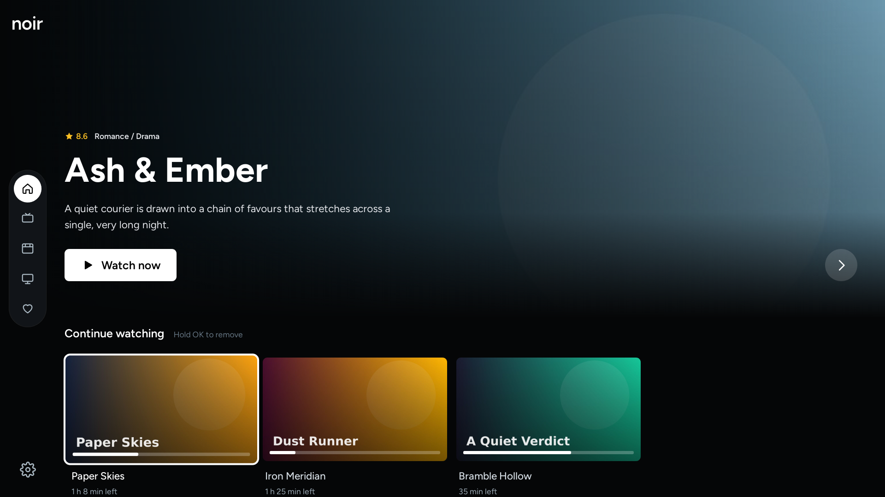

# Noir

An IPTV player for LG webOS TVs (Xtream Codes), plus its website.



Website: https://noir.aielbaz.com. The screenshots use invented demo content.

```
apps/tv           The webOS app (React + Vite). Packaged as an .ipk.
apps/website      noir.aielbaz.com (Astro, deployed to Cloudflare).
tools/demo-server Fake Xtream server with invented content, for screenshots and store review.
store/            LG Content Store listing: text, icon, screenshots, privacy policy, checklist.
noir-identity/    Brand files: icons, wordmark, splash.
```

pnpm workspace. Install once at the root:

```bash
pnpm install
```

| Command | What it does |
|---|---|
| `pnpm tv:dev` | Run the TV app in the browser |
| `pnpm tv:build` | Type-check and build the TV app |
| `pnpm tv:package` | Build and create `apps/tv/build/com.aielbaz.noir_<version>_all.ipk` |
| `pnpm site:dev` / `site:build` | Run or build the website |
| `pnpm site:deploy` | Build and deploy the website with wrangler |
| `pnpm demo` | Start the demo server on port 8089 (login: demo / demo) |

See `apps/tv/README.md` for installing on a TV and `tools/demo-server/README.md` for the demo server.

## License

[PolyForm Noncommercial 1.0.0](LICENSE). You can read, run and change the code for personal, educational and other noncommercial use. You may not use it commercially. This is a source-available licence, not an open-source one.

Noir doesn't include or provide any content. LG and webOS are trademarks of LG Electronics Inc.
